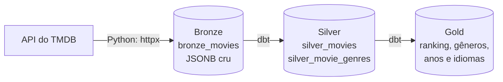

# Movie ETL Pipeline

Pipeline de dados em **arquitetura medalhão** (Bronze, Silver e Gold). Ele lê os filmes populares da API do TMDB com Python, guarda a resposta crua em PostgreSQL e usa **dbt** para transformar esse dado em tabelas limpas e em indicadores prontos para análise.



## Camadas

| Camada | Onde | O que contém | Quem gera |
|--------|------|--------------|-----------|
| Bronze | `public.bronze_movies` | Uma linha por página da API, em `JSONB`, exatamente como chegou, com o horário da extração | `src/` (Python) |
| Silver | `silver.*` | Filmes tipados, sem duplicatas, e a relação entre filmes e gêneros | dbt |
| Gold | `gold.*` | Tabelas agregadas para consumo: ranking, resumo por gênero, por ano e por idioma | dbt |

**Por que guardar o JSON cru no Bronze?** Se a regra de negócio ou o formato mudar, as camadas seguintes são refeitas a partir do dado original, sem chamar a API de novo. O Bronze funciona como o registro fiel do que a fonte entregou.

### Silver

- `silver_movies`: abre a lista `results` de cada página (`jsonb_array_elements`), converte os campos para os tipos certos (`int`, `date`, `numeric`, `boolean`) e mantém só a extração mais recente de cada filme.
- `silver_movie_genres`: um par filme e gênero por linha, com o nome do gênero vindo do seed `genres.csv`.

### Gold

| Tabela | Pergunta que responde |
|--------|-----------------------|
| `gold_popularity_ranking` | Quais são os filmes mais populares e como ficam por nota? |
| `gold_genre_summary` | Quais gêneros têm mais filmes, melhor nota média e mais votos? |
| `gold_release_year_summary` | Como os filmes populares se distribuem por ano de lançamento? |
| `gold_language_summary` | De quais idiomas vêm os filmes populares? |

Exemplo de saída de `gold_popularity_ranking`:

```
 popularity_rank |      title      | release_year | popularity | vote_average
-----------------+-----------------+--------------+------------+--------------
               1 | Fight Club      |         1999 |     61.400 |         8.40
               2 | The Dark Knight |         2008 |     58.900 |         8.50
               3 | Inception       |         2010 |     55.200 |         8.40
```

## Como executar

Pré-requisitos: [uv](https://docs.astral.sh/uv/), Python 3.12 ou superior e Docker (ou um PostgreSQL próprio).

```bash
cp .env.example .env        # preencha TMDB_API_TOKEN
make up                     # PostgreSQL em Docker
make pipeline               # ingestão + dbt run + dbt test
```

O `make pipeline` executa, em ordem:

1. `make ingest`: lê as páginas do TMDB e grava no Bronze.
2. `make dbt-run`: carrega o seed de gêneros e constrói Silver e Gold.
3. `make dbt-test`: roda os testes de qualidade.

### Sem token do TMDB

A pasta `tests/fixtures/` traz uma página de exemplo no mesmo formato da API. Ela permite rodar tudo sem credencial:

```bash
make up
make sample                 # carrega a amostra no Bronze
make dbt-run
make dbt-test
```

### Se você já tem um PostgreSQL

Ajuste `DB_HOST`, `DB_PORT`, `DB_NAME`, `DB_USER` e `DB_PASSWORD` no `.env` e pule o `make up`.

## Qualidade dos dados

`make dbt-test` executa 15 testes:

- `movie_id` único e não nulo em `silver_movies` e em `gold_popularity_ranking`;
- `vote_average` sempre entre 0 e 10 (teste genérico `value_between`);
- todo gênero ligado a um filme existente em `silver_movies` (`relationships`);
- chaves únicas nas tabelas Gold de gênero, ano e idioma.

Os testes de unidade do Python (`make test`) cobrem a extração, com um servidor HTTP simulado, e a carga no Bronze. O teste de carga é ignorado quando não há PostgreSQL disponível.

## Estrutura

```
.
├── src/
│   ├── extract.py        # API do TMDB para dicionários Python
│   ├── load.py           # grava no Bronze
│   ├── db.py             # conexão com o PostgreSQL
│   ├── pipeline.py       # ingestão completa
│   └── sample.py         # carrega a amostra local
├── dbt/
│   ├── dbt_project.yml
│   ├── profiles.yml      # lê as credenciais do ambiente
│   ├── seeds/genres.csv
│   ├── macros/
│   ├── tests/generic/
│   └── models/
│       ├── sources.yml
│       ├── schema.yml    # testes de qualidade
│       ├── silver/
│       └── gold/
├── tests/                # pytest e a amostra de dados
├── docker-compose.yml
├── Makefile
└── .env.example
```

## Decisões de projeto

- **A extração falha de forma explícita.** Se uma página der erro, a execução para. Carregar só parte das páginas deixaria o Bronze incompleto sem aviso.
- **Transformação no banco, com dbt.** SQL versionado, com dependências entre modelos (`ref`) e testes, em vez de lógica espalhada em scripts.
- **Bronze só adiciona.** Cada execução grava novas linhas. A deduplicação acontece no Silver, o que preserva o histórico de extrações.
- **Credenciais fora do código.** Tudo vem de variáveis de ambiente, e o `.env` está no `.gitignore`.

## Tecnologias

Python 3.12, httpx, psycopg2, loguru, PostgreSQL 16, dbt (dbt-postgres), pytest, Docker Compose e uv.
